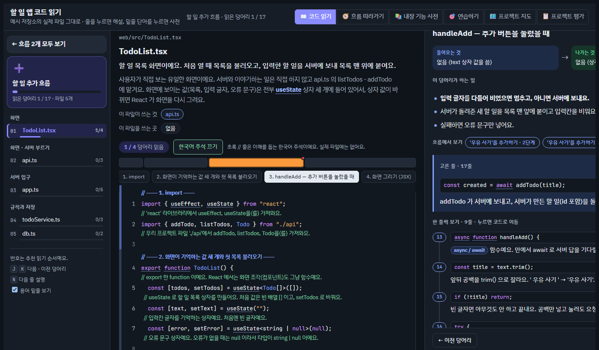
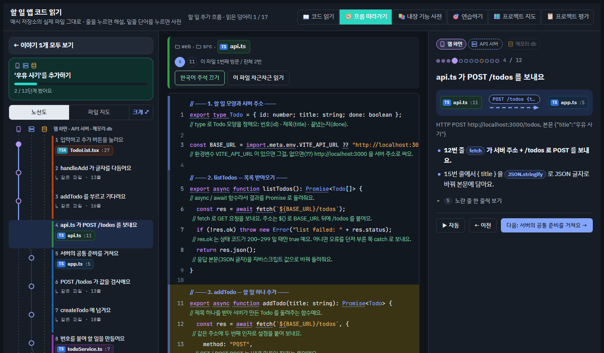
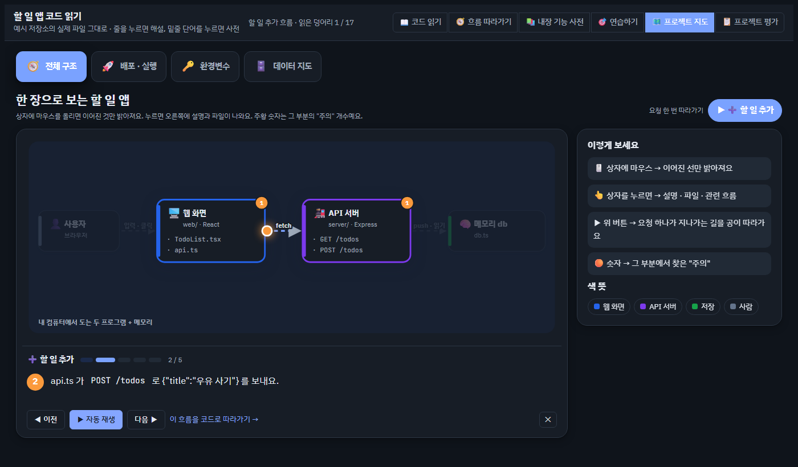
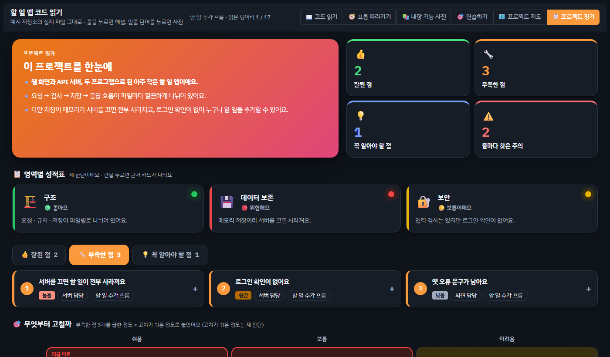
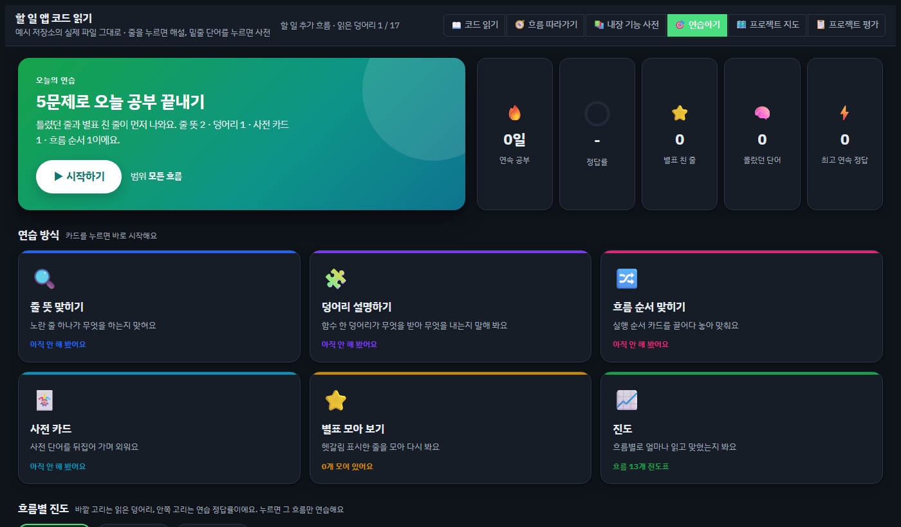

# study-my-code — 내 프로젝트를 AI 없이 이해하기 위한 Claude Code 스킬

AI 와 같이 만든 프로젝트는 돌아가긴 하는데, "이 줄이 왜 있어요?"라는 질문에는 막히기 쉬워요.
이 저장소의 스킬 3개는 **내 저장소의 실제 코드**를 근거로 공부 자료를 만들어 줘요. 결과물은 Claude 의 Artifact(인터랙티브 HTML 페이지)예요.

| 스킬 | 단위 | 이럴 때 | 이렇게 말하면 |
|---|---|---|---|
| **code-reader** | 줄 하나하나 | 코드를 직접 읽는 힘을 기르고 싶을 때. 코드가 바뀌면 바뀐 곳만 다시 | "이 저장소 코드 리더 만들어줘", "코드 리더 업데이트해줘" |
| **project-haeseolseo** | 결정 · 기능 한 칸씩 | 기술 면접에서 내 프로젝트를 끝까지 방어하고 싶을 때 | "이 프로젝트 해설서 만들어줘" |
| **codebase-anatomy** | 프로젝트 전체 구조 | 큰 그림(구조 · 요청 흐름 · 보안 · 결함)을 한 번에 보고 싶을 때 | "이 코드베이스 해부도 만들어줘" |

세 스킬 모두 **저장소를 고치지 않고**, 근거(파일:줄)를 달고, 비밀 값(API 키 · 토큰)은 싣지 않아요. 설명은 한국어예요(해부도는 요청한 언어).

## 설치

Claude Code 에서:

```text
/plugin marketplace add toadsam/claude-skills
/plugin install code-reader@study-my-code
/plugin install project-haeseolseo@study-my-code
/plugin install codebase-anatomy@study-my-code
```

셸에서는 `claude plugin marketplace add toadsam/claude-skills` → `claude plugin install code-reader@study-my-code`.
필요한 것만 골라 설치해도 돼요. code-reader 는 **Node.js 18+** 가 필요하고, 화면 확인용 스크린샷(`shot.js`)은 Chrome 이나 Edge 가 있으면 써요.

## code-reader

저장소의 실제 파일을 그대로 보여 주고, **코드가 있는 모든 줄에 한국어 해설**을 붙여요.



- **코드 읽기**: 흐름(기능)별 추천 순서, 덩어리 지도, 줄 해설, 밑줄 단어를 누르면 사전
- **흐름 따라가기**: 버튼 하나를 눌렀을 때 코드가 파일을 넘나드는 길을 단계별로(자동 재생)
- **내장 기능 사전**: 코드에 나오는 문법 · 라이브러리 이름을 "무엇 · 왜 · 예 · 이 저장소에서는"으로
- **연습하기**: 오늘의 5문제, 줄 뜻 맞히기, 순서 끌어 놓기, 사전 카드
- **프로젝트 지도**: 구조 그림과 요청 재생, 배포 단계, 환경변수(값은 가림), 데이터 지도, 커밋 그래프
- **프로젝트 평가**: 성적표, 무엇부터 고칠까(급함 × 쉬움), 주의 히트맵, 팀원 요청 체크리스트

| 흐름 따라가기 | 프로젝트 지도 |
|---|---|
|  |  |
| **프로젝트 평가** | **연습하기** |
|  |  |

**코드가 바뀌면?** 해설은 줄 번호가 아니라 **덩어리 지문**(코드 내용의 해시)에 묶여 있어요. `update.js` 가 지난 빌드와 지금 코드를 줄 단위로 맞춰서, 내용이 같은 덩어리는 줄 번호만 옮기고, 바뀐 덩어리만 "다시 쓰기" 목록에 올려요. 페이지에서는 바뀐 덩어리만 다시 "안 읽음"이 되고 "지난번 이후 바뀐 곳"에 모여요.

작업 데이터(해설 · 사전 · 기록표)는 저장소가 아니라 `~/.claude/code-reader/<프로젝트>/` 에 쌓여요. 예시는 [`plugins/code-reader/skills/code-reader/example/`](plugins/code-reader/skills/code-reader/example) — 아주 작은 할 일 앱과 그 작업 폴더예요. 직접 만들어 보려면:

```bash
cd plugins/code-reader/skills/code-reader
node engine/build.js example/workspace
node engine/smoke.js example/workspace
```

`example/workspace/out/code-reader.html` 을 브라우저로 열면 돼요.

## project-haeseolseo

프로젝트의 핵심 결정 · 코드 경로 · 트러블슈팅 커밋마다 **칸**을 하나씩 만들어요. 칸마다 한 줄 요약, 바닥 원리와 비유, 눌러 보는 재현 실험, 실제 코드, 정직 표시, "다시 한다면" 비교표, 예상 질문(기본 · 꼬리 · 압박)과 1인칭 답, 면접 전 확인 체크리스트가 들어가요. 맨 끝에는 용어 사전과 무작위 모의 면접 카드가 있어요.

- 기준은 **GitHub 저장소**예요. 포트폴리오 사이트 · 이력서의 주장은 저장소와 대조만 해요.
- 팀 프로젝트면 `git blame` · 커밋으로 **내 몫과 팀 몫**을 갈라 "그건 누가 했나요?"에 대비해요.

## codebase-anatomy

실제 소스에서 **명령으로 뽑은** 숫자와 그래프로 해부도를 만들어요: 몇 개의 프로그램이 도는지, 계층 구조, 요청 추적기(여러 시나리오를 한 걸음씩), 처음부터 쌓는 보안 기초, 데이터 모델, git 으로 본 프로젝트 역사, 근거가 붙은 결함 목록과 잘된 점, 손으로 해 보는 실습과 퀴즈.

## 저장소 구조

```
.claude-plugin/marketplace.json     플러그인 3개 목록
plugins/<이름>/.claude-plugin/plugin.json
plugins/<이름>/skills/<이름>/SKILL.md   Claude 가 읽는 작업 순서와 규칙
                             references/   자세한 규칙 · 예시
                             assets/ · engine/   페이지 틀 · 스크립트
docs/screenshots/                   README 사진 (code-reader 예시로 찍음)
```

## 라이선스

MIT
