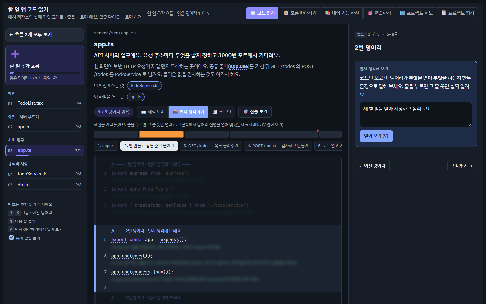
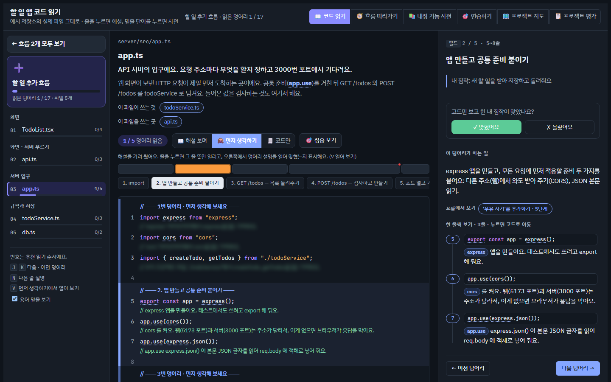
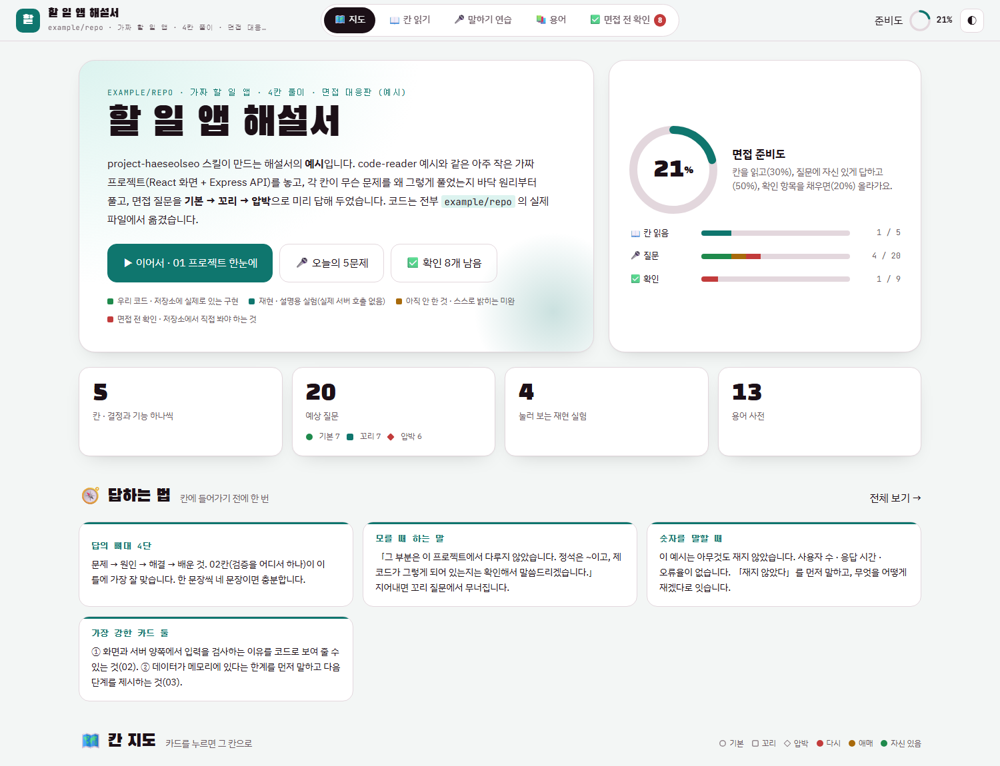
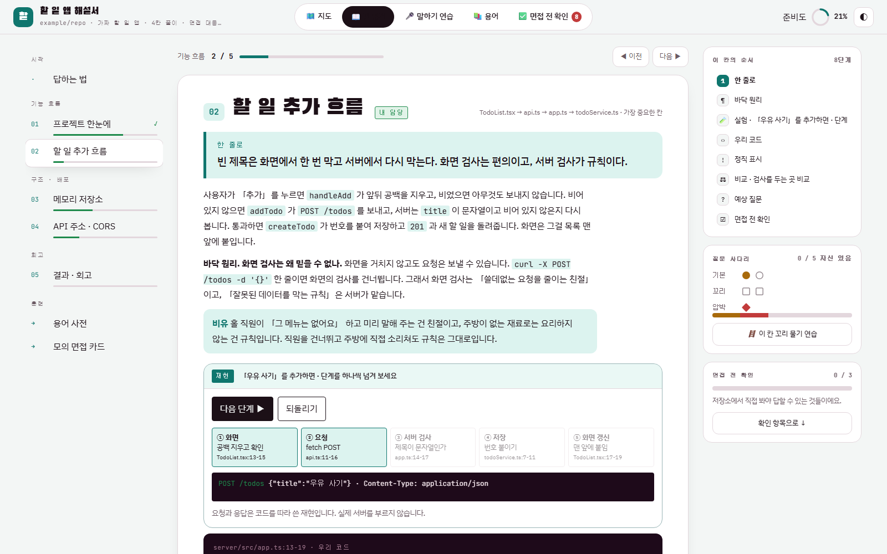
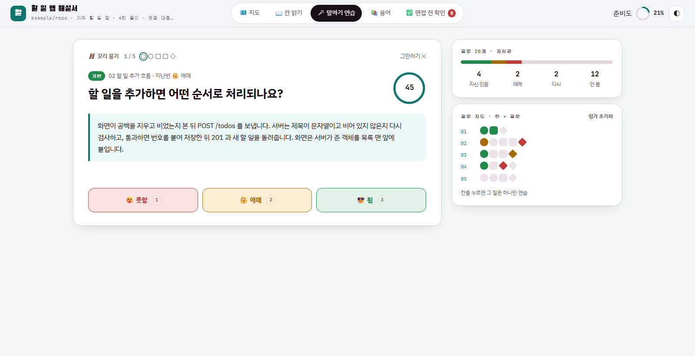
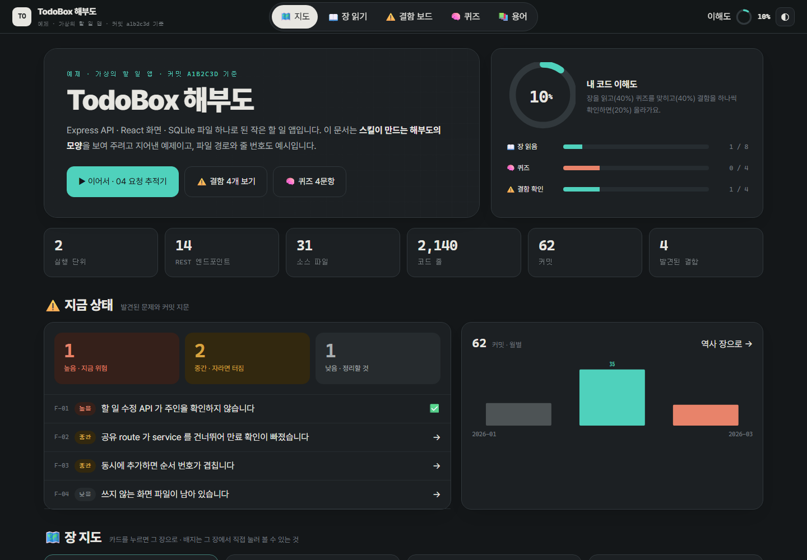
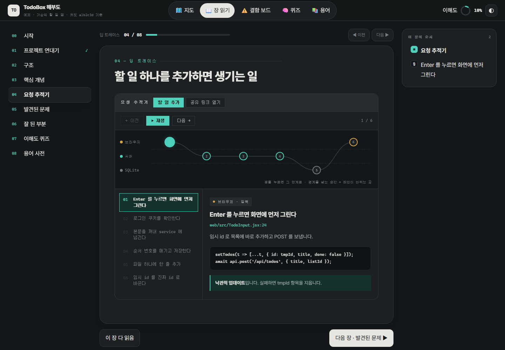
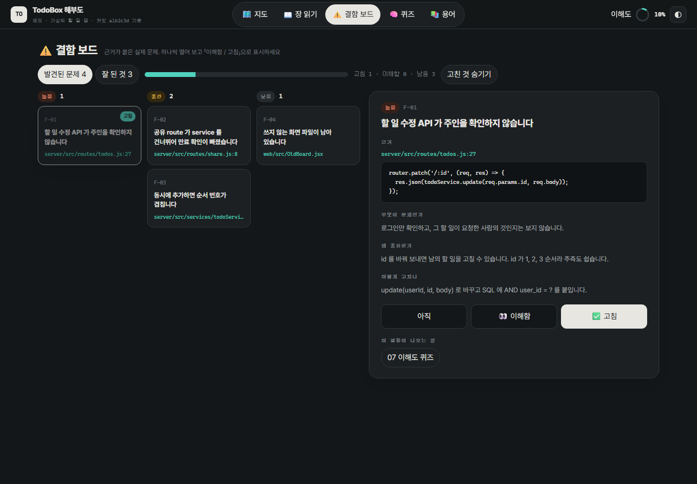
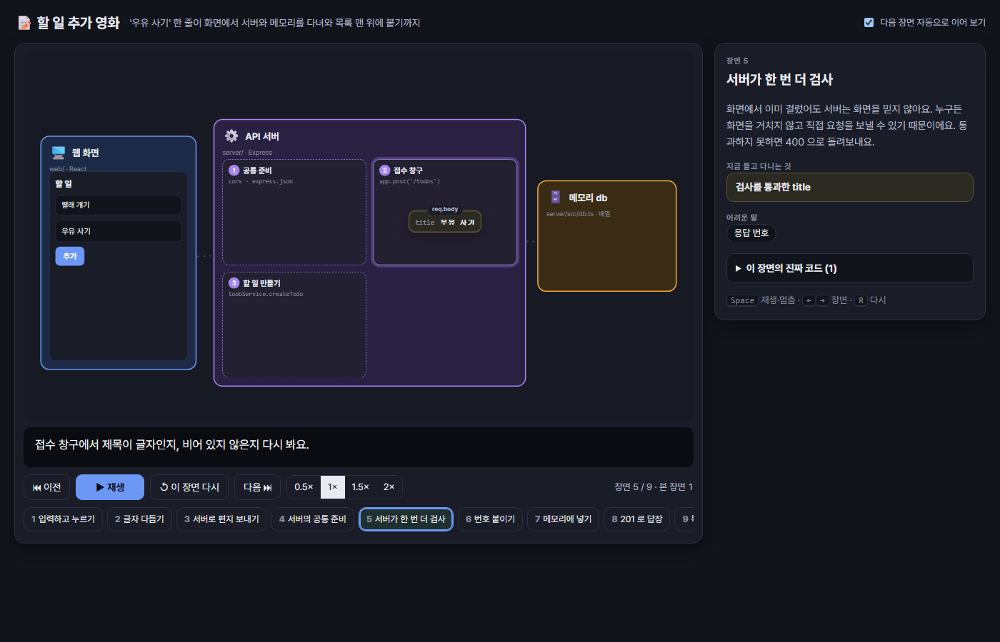
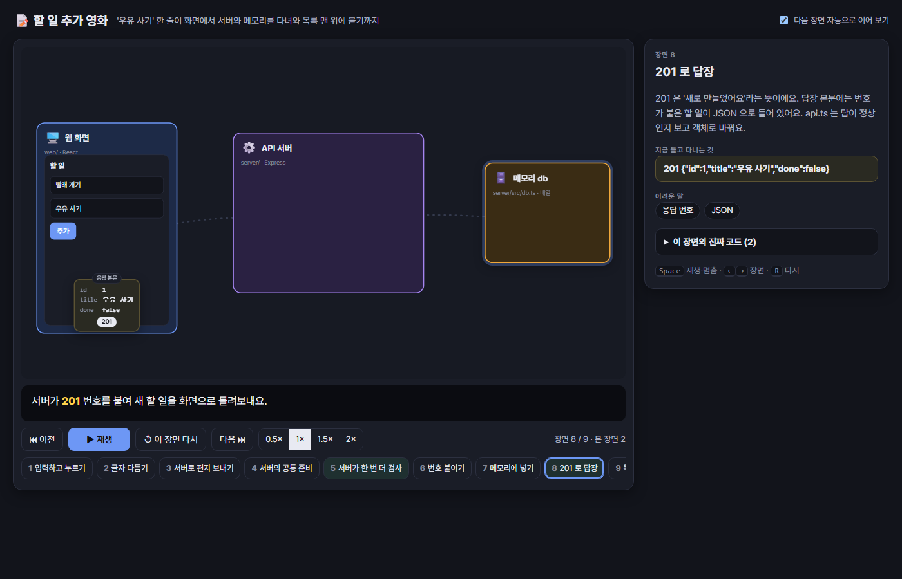

# study-my-code — 내 프로젝트를 AI 없이 이해하기 위한 Claude Code 스킬

AI 와 같이 만든 프로젝트는 돌아가긴 하는데, "이 줄이 왜 있어요?"라는 질문에는 막히기 쉬워요.
이 저장소의 스킬 4개는 **내 저장소의 실제 코드**를 근거로 공부 자료를 만들어 줘요. 결과물은 Claude 의 Artifact(인터랙티브 HTML 페이지)예요.

네 스킬은 같은 저장소를 **다른 높이**에서 봐요. 해부도는 하늘에서 내려다본 지도, 코드 리더는 한 줄씩 들여다보는 돋보기, 해설서는 면접관 앞에서 펼치는 답안 노트예요. 코드 영화는 코드를 아직 못 읽어도 볼 수 있게, 흐름 하나를 움직이는 그림으로 보여 줘요.

| 스킬 | 보는 높이 | 한 번 보고 나면 | 이렇게 말하면 |
|---|---|---|---|
| **codebase-anatomy** | 프로젝트 전체 | "이 프로젝트는 무엇무엇으로 이뤄져 있고, 요청이 이렇게 지나가고, 여기가 위험하다"를 말할 수 있어요 | "이 코드베이스 해부도 만들어줘" |
| **code-reader** | 줄 하나하나 | 아무 파일이나 열어도 "이 줄은 이걸 하려고 있다"를 말할 수 있어요 | "이 저장소 코드 리더 만들어줘", "코드 리더 업데이트해줘" |
| **project-haeseolseo** | 결정 하나하나 | "왜 이렇게 만들었어요? 다른 방법은요?"에 근거를 들어 답할 수 있어요 | "이 프로젝트 해설서 만들어줘" |
| **code-movie** | 흐름 하나 | 버튼 하나를 누르면 값이 앱, 서버, DB 를 어떤 순서로 오가는지 그림으로 말할 수 있어요 | "이 기능 코드 영화로 만들어줘", "애니메이션으로 보여줘" |

## 어떤 걸 쓸까요?

지금 상황에 맞는 줄을 찾아보세요.

| 이런 상황이라면 | 이걸 쓰세요 |
|---|---|
| 팀 프로젝트에 새로 들어갔거나, 오래전에 만든 내 프로젝트가 기억나지 않는다 | **codebase-anatomy** — 먼저 큰 그림부터 |
| 서비스에 보안 구멍 · 위험한 코드가 있는지 근거와 함께 알고 싶다 | **codebase-anatomy** — 결함 보드 |
| 프로그램(브라우저 · 서버 · DB)끼리 요청이 어떻게 오가는지 알고 싶다 | **codebase-anatomy** — 요청 추적기 |
| AI 가 짜 준 코드가 돌아가긴 하는데 한 줄 한 줄은 설명을 못 하겠다 | **code-reader** |
| 버튼 하나를 눌렀을 때 어떤 **파일 · 함수**를 어떤 순서로 지나가는지 코드로 따라가고 싶다 | **code-reader** — 흐름 따라가기 |
| 해설 없이도 코드를 읽는 힘을 매일 조금씩 기르고 싶다 | **code-reader** — 🙈 먼저 생각하기 · 연습하기 |
| 코드 리뷰 · 팀원 PR 전에 바뀐 부분만 빠르게 따라잡고 싶다 | **code-reader** — 업데이트 후 "지난번 이후 바뀐 곳" |
| 기술 면접 · 포트폴리오 발표가 다가온다 | **project-haeseolseo** |
| "왜 이 기술을 골랐어요?", "다시 만든다면요?" 같은 꼬리 질문이 무섭다 | **project-haeseolseo** — 말하기 연습 |
| 이력서에 쓴 내용이 실제 코드로 뒷받침되는지 확인하고 싶다 | **project-haeseolseo** — 저장소와 대조 |
| 팀 프로젝트에서 내가 한 부분과 팀이 한 부분을 갈라 말해야 한다 | **project-haeseolseo** — 내 몫 · 팀 몫 |
| 코드를 아직 못 읽지만 내 서비스가 어떻게 돌아가는지는 알고 싶다 | **code-movie** |
| 팀원이나 비개발자에게 기능 하나가 도는 과정을 보여 주고 싶다 | **code-movie** |

**여러 개를 쓴다면 이 순서가 좋아요.** 해부도로 큰 그림을 잡고 → 코드 리더로 매일 조금씩 줄 단위로 읽고 → 면접 · 발표 전에 해설서로 말하는 연습을 해요. 위에서 아래로 내려갈수록 자세해져요. 코드가 아직 낯설다면 코드 영화로 중요한 흐름 몇 개를 먼저 보고 시작해도 좋아요.

**이럴 땐 안 써도 돼요.** 파일 몇 개짜리 작은 스크립트라면 Claude 에게 바로 물어보는 편이 빨라요. 이 스킬들은 여러 파일 · 여러 기능이 얽힌 저장소에서 제값을 해요.

네 스킬 모두 **저장소를 고치지 않고**, 근거(파일:줄)를 달고, 비밀 값(API 키 · 토큰)은 싣지 않아요. 설명은 한국어예요(해부도는 요청한 언어).

## 결과물은 어디 생기나요?

**결과물은 Claude 의 Artifact 예요.** 스킬을 쓴 사람의 claude.ai 계정에 페이지가 하나 생기고, 처음에는 본인만 볼 수 있어요(공유는 직접 정해요). 이 저장소나 분석한 프로젝트 저장소에는 아무것도 생기지 않아요.

페이지의 원본 파일과 링크는 내 컴퓨터의 **프로젝트마다 폴더 하나**에 모여요. 네 스킬이 같은 폴더를 함께 써요.

```
~/.claude/study-my-code/<프로젝트>/
  links.json      결과물의 Artifact 주소 — 다음에 "업데이트해줘" 하면 여기서 찾아요
  code-reader/    코드 리더 작업 폴더 (줄 해설 · 사전 · 흐름 · 기록표)
  haeseolseo/     해설서 원본 HTML
  anatomy/        해부도 원본 HTML
  movie/          코드 영화 각본(영화마다 JSON 하나)과 만든 페이지
```

- **다시 만들면 같은 주소로 갱신돼요.** 읽음 · 체크 · 퀴즈 기록은 그 주소에 묶여 브라우저에 저장되기 때문에, 새 페이지를 만들지 않고 같은 주소를 이어 써요.
- 이 폴더는 저장소 밖이라 실수로 커밋될 일이 없고, 세션이 끝나도 남아요.
- 예전 버전의 code-reader 는 `~/.claude/code-reader/<프로젝트>/` 를 썼어요. 거기 작업 폴더가 있으면 새 위치로 복사해서 이어 쓰고, 옛 폴더는 지우지 않아요.

## 설치

저장소 이름은 `claude-skills` 이고, 설치할 때 쓰는 마켓플레이스 이름은 `study-my-code` 예요(`.claude-plugin/marketplace.json` 의 `name`). 그래서 추가할 때는 저장소 이름을, 설치할 때는 `@study-my-code` 를 써요.

Claude Code 에서:

```text
/plugin marketplace add toadsam/claude-skills
/plugin install code-reader@study-my-code
/plugin install project-haeseolseo@study-my-code
/plugin install codebase-anatomy@study-my-code
/plugin install code-movie@study-my-code
```

셸에서는 `claude plugin marketplace add toadsam/claude-skills` → `claude plugin install code-reader@study-my-code`.
필요한 것만 골라 설치해도 돼요. code-reader 와 code-movie 는 **Node.js 18+** 가 필요하고, 화면 확인용 스크린샷(`shot.js`)은 Chrome 이나 Edge 가 있으면 써요.

## code-reader

저장소의 실제 파일을 그대로 보여 주고, **코드가 있는 모든 줄에 한국어 해설**을 붙여요.

> **언제 열어 볼까요?** 매일 10~20분씩, 오늘 읽을 흐름 하나를 골라 읽을 때 · 팀원이 코드를 바꾼 뒤 "뭐가 달라졌지?" 싶을 때 · 모르는 함수나 라이브러리 이름이 나왔을 때(사전) · 해설 없이 읽히는지 스스로 시험해 보고 싶을 때(🙈 먼저 생각하기).


- **코드 읽기**: 흐름(기능)별 추천 순서, 덩어리 지도, 줄 해설, 밑줄 단어를 누르면 사전. 읽는 방식은 📖 해설 보며 · 🙈 먼저 생각하기 · 🧾 코드만 세 가지이고, 🎯 집중 보기를 켜면 고른 덩어리 밖이 흐려져요
- **흐름 따라가기**: 버튼 하나를 눌렀을 때 코드가 파일을 넘나드는 길을 단계별로(자동 재생)
- **내장 기능 사전**: 코드에 나오는 문법 · 라이브러리 이름을 "무엇 · 왜 · 예 · 이 저장소에서는"으로
- **연습하기**: 오늘의 5문제, 줄 뜻 맞히기, 순서 끌어 놓기, 사전 카드
- **프로젝트 지도**: 구조 그림과 요청 재생, 배포 단계, 환경변수(값은 가림), 데이터 지도, 커밋 그래프
- **프로젝트 평가**: 성적표, 무엇부터 고칠까(급함 × 쉬움), 주의 히트맵, 팀원 요청 체크리스트

| 흐름 따라가기 | 프로젝트 지도 |
|---|---|
|  |  |
| **프로젝트 평가** | **연습하기** |
|  |  |

**🙈 먼저 생각하기** — AI 해설에 기대지 않고 읽는 연습이에요. 줄 해설과 덩어리 설명을 가려 두고, 코드만 보고 짐작을 적은 뒤 열어 봐요. 덩어리마다 「맞혔어요 / 몰랐어요」를 남기면, 몰랐던 덩어리가 연습하기 · 오늘의 5문제에 먼저 나오고 맞히면 풀려요.

| 가린 채로 짐작 쓰기 | 열어 보고 스스로 채점 |
|---|---|
|  |  |

**코드가 바뀌면?** 해설은 줄 번호가 아니라 **덩어리 지문**(코드 내용의 해시)에 묶여 있어요. `update.js` 가 지난 빌드와 지금 코드를 줄 단위로 맞춰서, 내용이 같은 덩어리는 줄 번호만 옮기고, 바뀐 덩어리만 "다시 쓰기" 목록에 올려요. 페이지에서는 바뀐 덩어리만 다시 "안 읽음"이 되고 "지난번 이후 바뀐 곳"에 모여요.

작업 데이터(해설 · 사전 · 기록표)는 저장소가 아니라 `~/.claude/study-my-code/<프로젝트>/code-reader/` 에 쌓여요. 예시는 [`plugins/code-reader/skills/code-reader/example/`](plugins/code-reader/skills/code-reader/example) — 아주 작은 할 일 앱과 그 작업 폴더예요. 직접 만들어 보려면:

```bash
cd plugins/code-reader/skills/code-reader
node engine/build.js example/workspace
node engine/smoke.js example/workspace
```

`example/workspace/out/code-reader.html` 을 브라우저로 열면 돼요.

## project-haeseolseo

> **언제 열어 볼까요?** 면접 · 발표 1~2주 전부터 하루에 몇 칸씩 · 면접 전날 "면접 전 확인"으로 숫자와 사실 점검 · 꼬리 질문에 막혔던 날 그 칸만 다시(말하기 연습).

프로젝트의 핵심 결정 · 코드 경로 · 트러블슈팅 커밋마다 **칸**을 하나씩 만들어요. 칸마다 한 줄 요약, 바닥 원리와 비유, 눌러 보는 재현 실험, 실제 코드, 정직 표시, "다시 한다면" 비교표, 예상 질문(기본 · 꼬리 · 압박)과 1인칭 답, 면접 전 확인 체크리스트가 들어가요.



- **지도**: 면접 준비도(칸 읽음 · 질문 자신감 · 확인 항목), 답하는 법 카드, 칸마다 질문 점(모양은 기본 · 꼬리 · 압박, 색은 자신감)
- **칸 읽기**: 한 칸씩. 처음 보는 칸은 한 줄 요약을 가려 두고 먼저 말해 보게 해요. 오른쪽에 이 칸의 단계 목록과 질문 사다리
- **말하기 연습**: 카드 섞기 · 꼬리 물기(한 칸을 기본 → 꼬리 → 압박으로) · 압박 면접(시간 제한). 답을 연 뒤 "못함 / 애매 / 됨"으로 스스로 평가하고, 약한 질문이 먼저 나와요
- **용어** · **면접 전 확인**: 검색 · 뜻 가리기, 모든 칸의 확인 항목을 한곳에

| 칸 읽기 | 말하기 연습 |
|---|---|
|  |  |

- 기준은 **GitHub 저장소**예요. 포트폴리오 사이트 · 이력서의 주장은 저장소와 대조만 해요.
- 팀 프로젝트면 `git blame` · 커밋으로 **내 몫과 팀 몫**을 갈라 "그건 누가 했나요?"에 대비해요.
- 내용(칸 HTML)과 화면 껍데기가 나뉘어 있어서, 예전에 만든 해설서도 `node scripts/upgrade.js 해설서.html` 로 새 화면을 입힐 수 있어요. 체크 · 평가 기록은 그대로 이어져요.
- 예시는 [`plugins/project-haeseolseo/skills/project-haeseolseo/example/todo-haeseolseo.html`](plugins/project-haeseolseo/skills/project-haeseolseo/example/todo-haeseolseo.html) — code-reader 예시와 같은 가짜 할 일 앱의 해설서예요. 브라우저로 바로 열 수 있어요.

## codebase-anatomy

> **언제 열어 볼까요?** 프로젝트를 처음 맡았을 때 한 번 통째로 · 큰 기능을 붙이기 전에 어디에 붙일지 볼 때 · 배포 · 보안 점검 전에 결함 보드를 훑을 때 · 남에게 프로젝트 구조를 설명해야 할 때.

실제 소스에서 **명령으로 뽑은** 숫자와 그래프로 해부도를 만들어요: 몇 개의 프로그램이 도는지, 계층 구조, 요청 추적기(여러 시나리오를 한 걸음씩), 처음부터 쌓는 보안 기초, 데이터 모델, git 으로 본 프로젝트 역사, 근거가 붙은 결함 목록과 잘된 점, 손으로 해 보는 실습과 퀴즈.



- **지도**: 내 코드 이해도(장 읽음 · 퀴즈 · 결함 확인), 심각도별 결함 수와 가장 급한 결함, 월별 커밋, 장 카드
- **장 읽기**: 한 장씩. 요청 추적기는 프로그램(브라우저 · 서버 · DB …)을 줄로 그린 그림 위에서 요청이 한 칸씩 움직이고, 점을 누르면 그 단계로 가요
- **결함 보드**: 심각도별 칸, 결함마다 근거 코드 · 무엇이 문제 · 왜 중요 · 고치는 법, "이해함 / 고침" 표시, 잘된 점 탭
- **퀴즈** · **용어**: 한 문제씩(답 기억), 검색 · 뜻 가리기

| 장 읽기 · 요청 추적기 | 결함 보드 |
|---|---|
|  |  |

- 해설서처럼 내용(장 · 데이터)과 화면 껍데기가 나뉘어 있어서, 예전 해부도도 `node scripts/upgrade.js 해부도.html` 로 새 화면을 입힐 수 있어요.
- 예시는 [`plugins/codebase-anatomy/skills/codebase-anatomy/example/todo-anatomy.html`](plugins/codebase-anatomy/skills/codebase-anatomy/example/todo-anatomy.html) — 가짜 할 일 앱(TodoBox)의 해부도예요. 경로 · 숫자는 전부 예시예요.

## code-movie

> **언제 열어 볼까요?** 코드를 읽기 전에 "이 버튼을 누르면 무슨 일이 일어나지?"부터 알고 싶을 때, 남에게 기능 하나를 설명해야 할 때, 코드 리더로 읽은 흐름을 그림으로 다시 정리하고 싶을 때.

무대에 앱, 서버, DB, 바깥 서비스 상자를 놓고, 실제 예시 값(입력한 글자, 주문 하나 같은 것)이 카드가 되어 상자 사이를 오가는 영화를 만들어요. 서버 상자를 확대하면 안의 클래스가 방으로 나뉘어 보이고, 카드가 방을 차례로 지나가요.

| 서버 안의 방을 지나가는 장면 | 답장이 화면으로 돌아오는 장면 |
|---|---|
|  |  |

- 자막은 코드 용어 없이 쉬운 말로 쓰고, 어려운 말은 눌러서 풀이를 봐요.
- 장면마다 "이 장면의 진짜 코드"를 펼치면 근거 파일과 줄이 나와요. 이 코드는 빌드할 때 저장소에서 그대로 읽어 넣어요. 손으로 옮겨 적지 않아요.
- 재생, 멈춤, 속도(0.5×~2×), 장면 타임라인이 있고, 본 장면은 브라우저에 기억돼요.
- 흐름이 여러 개면 영화를 여러 편 만들어 한 페이지(극장)에 모아요. code-reader 의 흐름 따라가기 이야기가 있으면 그걸 뼈대로 써요.
- 각본(JSON)만 쓰고 그림 코드는 엔진이 맡아요. `check.js` 가 상자, 카드, 동작, 코드 근거 줄 범위를 검사하고, `smoke.js` 가 화면 없는 Chrome 에서 처음부터 끝까지 재생해 봐요.

예시는 [`plugins/code-movie/skills/code-movie/example/`](plugins/code-movie/skills/code-movie/example) 에 있어요. code-reader 예시와 같은 할 일 앱의 "할 일 추가" 영화(9장면)예요. 직접 만들어 보려면:

```bash
cd plugins/code-movie/skills/code-movie
node engine/check.js example/workspace
node engine/build.js example/workspace
```

`example/workspace/out/movie.html` 을 브라우저로 열면 돼요.

## 저장소 구조

```
.claude-plugin/marketplace.json     플러그인 4개 목록
plugins/<이름>/.claude-plugin/plugin.json
plugins/<이름>/skills/<이름>/SKILL.md   Claude 가 읽는 작업 순서와 규칙
                             references/   자세한 규칙 · 예시
                             assets/ · engine/ · scripts/   페이지 틀 · 스크립트
                             example/      개인 정보 없는 예시
docs/screenshots/                   README 사진 (예시 프로젝트로 찍음)
```

## 라이선스

MIT
